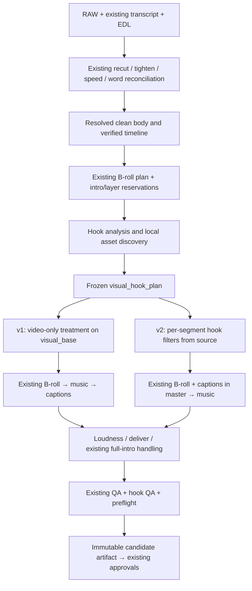

# Visual Hook Engine — architecture specification

2026-09-11 • Proposal only • No production changes authorized in this preparation session.

## 1. Scope and invariant

Visual Hook Engine is an editorial selector plus a deterministic, video-only treatment. It improves the readability of an opening **when evidence supports an improvement**. It never manufactures a promise, moves speech, inserts extra duration, replaces Hebrew captions, changes music, or schedules content. NO_OP is a successful editorial result.

MVP runtime recipes: `NO_OP`, `SMART_PUNCH_IN`. Phase 2: opt-in `PAYOFF_PREVIEW`, contingent on an explicit canon exception and pilot evidence. Other registry entries remain disabled. Feature modes: `off` (legacy default), `shadow` (analysis only), `auto` (approved rollout cohorts only). A user's explicit disabled preference beats every CLI, score and learned weight.

## 2. Actual current flow and inspected integration surfaces

| Stage | Actual code / behavior | Implication |
|---|---|---|
| Identity and source | `tools/relvid/registry.py`, manifests; `project_id`, not folder title, is identity. SQLite is an index. | Bind plans to project_id and media digests. No mass manifest migration. |
| ASR | `tools/align_words.py`: faster-whisper word timestamps with Hebrew glossary. `align_reconcile.py`: sequence matching/interpolation to corrected text. | Existing timestamps are not a new phoneme-level forced aligner. Reuse and validate; never create a second hook transcript. |
| Edit decisions | `edl_build.py`, `edl-policy.json`: duplicate-take logic, opening protection, timed keeps/cuts. Director pipeline in `local_finish_pipeline.py` can compile reviewed decisions. | Keep all existing semantic and hook safeguards. Do not use visual motion to revise EDL. |
| Clean export | `edl_cut.py` renders kept segments and concatenates. Tightening/speed can produce `EXPORT_TIGHT.mp4`. Refine flow reconciles final words. | The resolved `EXPORT` variable is the body base; `EXPORT_TIGHT` is not guaranteed to exist. |
| B-roll planning | `broll_pick.py`, `broll_director.py`: sentence evidence, audience/person safeguards, continuous bed or anchors, snap to cuts. Manual/pinned choices and explicit empty director choice matter. | Share reservations, not selection authority. Hook cannot silently overwrite a B-roll decision. |
| Render v1 | `local_finish_pipeline.py` chooses base, then multiple B-roll paths explicitly overlay on `EXPORT`; later music, PIL captions, loudness, delivery. | Adding a new `base` assignment alone is insufficient: route all consumers through a named `visual_base`. |
| Render v2 | `tools/relvid/render.py:build_timeline`, `render_segment`: INPUT+EDL+tight mapping/source overrides → cached segments with B-roll and captions → PCM master. | A patched EXPORT is ignored. Compile the same hook plan into segment filters before captions. |
| Stall fallback | Pipeline can fall back from v2 to v1 after a render stall. | Reproduce the same approved treatment in v1; never silently drop it. |
| Existing visual layers | `animation_overlay.py`, optional fixed-intro glass effect; `illustration_build.py`, placement and gate; no automatic illustration build invocation found in finish pipeline. | Do not assume an illustration stage already exists. Existing manually composed layers require explicit provenance and reservations. |
| Verification and finish | Pre-music audio re-ASR, music ducking, captions (v1), loudness, delivery. Full format intro can be prepended **after delivery**, with word/verification offsets. | Analyze body and final clocks separately. Audio truth remains the existing output audio. |
| QA and promotion | Cut/caption/canon/lexicon/qa gates and preflight before candidate promotion; `PENDING`→`FINAL`. | Hook checks join this path. No parallel publish command. |
| Approval and scheduling | review-app approval→locked `run_finish.py`/runner→immutable artifacts; cover/caption approval and artifact checksum→ready_to_schedule. | Freeze hook sidecars and approval binding. Preserve all existing approval gates. |

Useful anchors as inspected (line numbers are approximate after future edits): pipeline `main` ~494, default engine option ~578, v2 branch ~1098, base selection ~1193; render `build_timeline` ~286, `_segment_key` ~486, `render_segment` ~726; `qa_gates.py` G8 ~209; registry `set_finish_prefs` ~184; runner `build_command` ~125. Verify symbols against `evidence/source_snapshot.json`, not these numbers alone.

### Documentation drift: do not accidentally turn an audit into a policy rewrite

- Local skill heading v9.21, code newer v9.22, user-pasted guidance v9.13 and PIPELINE older headings/counts coexist.
- The canonical skill refers to `00 - REL-OS/03_SKILLS/00_META/VIDEO-CANON.md` v2.1. Its B-roll/content restrictions differ from active anchors-only behavior and other skill sections. This conflict remains a policy issue, not permission for extra opening B-roll.
- Music defaults also drift: live pipeline CLI is -46 LUFS with ducking; old prose includes -44/-55 and canon -38/no ducking. Hook work must preserve actual existing audio behavior and avoid harmonizing these unrelated rules.
- `learn_from_edits --apply` is an alias for proposing in shadow, not direct global mutation despite old runbook wording.
- Actual registry audit counts are137 gates and60 lessons; do not freeze these as future promised counts.

## 3. Integration point and proposed flow



Do not literally move every old stage to match a diagram. Extract/reuse only the B-roll plan resolution necessary before hook selection; leave rendering and audio order unchanged. Early asset discovery may run against raw sources, but selection must bind the final body timeline. Refine/refinish uses the same resolver.

Conceptual interface:

```python
context = HookContext.from_resolved_finish(
    project_id, clean_body, source_map, words_final,
    existing_broll_plan, caption_profile, intro_resolution, approved_layers)
if mode == 'off':
    return legacy_finish_unchanged()
analysis = analyze(context)                 # local, cached, provenance checked
candidates = discover_and_rank(context, analysis)
plan = reuse_approved_or_select(context, candidates, explicit_preferences)
validate_plan(plan, context)                # facts/contract, not taste thresholds
if mode == 'shadow':
    write_report(plan, applied=False)
    return legacy_finish_unchanged()
# v1 and v2 compile from this same plan; neither gets to make editorial choices
```

### Layer ownership

1. Original speech, EDL, duration and word timeline are immutable to this engine.
2. Transform body picture (crop, or later approved silent picture replacement).
3. Existing B-roll reservations retain priority. Do not crop B-roll as though it were the speaker.
4. Approved illustration/format effects retain their documented ownership. Conflict chooses a simpler hook or NO_OP; never bypass illustration gates by renaming an illustration a hook.
5. Captions are composed once and last among body visual layers, through atomic `BRAND_PROFILES` and `band_box` geometry.
6. Full intro remains the existing special case. Default automatic hook decision for a resolved full intro is NO_OP with `fixed_intro_present` reason. Resolve by existing title/format logic too; `manifest.full_intro == null` alone is insufficient.

The clean export is kept unchanged for existing QA/cover contracts. A hook-treated body is a derived file, never written over EXPORT or FINAL. Cover selection continues using the clean source, not a transition, frozen preview or caption frame.

## 4. Timelines and exact rendering contract

Use **integer frames, 30/1**, half-open intervals `[start_frame,end_frame)`. The hook plan lives on `body_final`: after recut, tightening and speed, before a full intro. Also record the actual intro frame offset for QA on `delivered_final`.

- Source intervals additionally carry original rational timebase/PTS or source seconds sufficient for frame extraction. A source interval is not a body-output interval.
- `render.py` stores `Segment.out_start` pre-speed; `out_start_final = out_start/speed`. Caption and B-roll local timing already accounts for output timing. Translate hook frame intervals to graph time **once**; do not divide by speed twice.
- Intersect hook intervals with each segment's final-frame span. Preserve the existing cumulative rounding and `n_frames` exactly. Prefer adding crop filters to affected segments rather than new segment splits. If a future recipe requires splits, their integer frame counts must sum exactly to the original segment.
- A silent payoff preview repeats picture from a later source interval over the existing opening picture. It does not prepend a clip, repeat speech, add its audio, move the original payoff, or lengthen the output. If narrative meaning would be false, it is ineligible.
- Preserve existing HDR/HLG normalization and source override validation; do not introduce color grading.
- Keep all cues outside the reserved hook interval at the identity transform, including exact entry/exit values. The last treatment frame and next ordinary frame must not create an accidental crop jump.

### v1

`render_v1(clean_body, plan, output_temp) -> visual_base, receipt`. NO_OP returns the same path without decoding. For crop, create a video-only derived picture with the same total frames; preserve the original audio stream contract. All manual/director/auto B-roll `--base` invocations must use `visual_base`, while source analysis/cover still receives clean_body. No hidden change to CRF or music defaults.

v1 re-encoding can alter decoded pixels outside the hook even with identity filters. Therefore compare it against a matching identity control render when measuring spatial differences; never promise bit-identical video outside the window after an extra lossy generation. The cost of this generation is a reason to keep the MVP subtle and prefer native v2 for eventual scale.

### v2

Add optional hook IR to Segment, compile before existing B-roll and caption overlays. Preserve source audio processing and frame count. Cache key includes semantic hook fragment digest only for affected segments; NO_OP/off keep old key construction byte-for-byte. Existing source fingerprints use filename/size/integer mtime, which can miss some changes: new hook assets require content hashes. Avoid a broad cache refactor in this feature.

A fallback rerun must compile the same frozen plan through v1; missing assets or invalid plan stop the **candidate** and preserve the previous approved artifact. A rendering error must not silently replace an approved effect with NO_OP. Automatic NO_OP is allowed during selection before approval, not as undocumented post-approval error recovery.

## 5. Data contracts and files

Prefix `visual_hook_` follows existing `broll_plan.json` / `illustration_plan.json` and avoids generic `hook` ambiguity with verbal editing policy.

| Workdir output | Contract |
|---|---|
| `visual_hook_analysis.json` | schema_version, project_id, input_digest, body clock, quoted verbal hook/word IDs, promise/payoff/desired emotion, content type, local window measurements, protected regions, evidence and unknowns. Semantic text must cite actual words. |
| `visual_hook_candidates.json` | stable candidate IDs, recipe+version, source assets/intervals, eligibility with reason codes, feature vector, score components, evidence grade, rejection reasons; includes NO_OP. |
| `visual_hook_plan.json` | immutable semantic render instruction once approved: recipe, policy snapshot, context hashes, cue frames, normalized crop path/assets, layer reservations, declared transitions, audio_mode preserve, renderer compatibility. |
| `visual_hook_render.json` | render receipt: plan digest, actual input/output hashes, renderer/version, frame count, actual emitted transition frames, runtime diagnostics. Timestamps belong here, not the semantic plan digest. |
| `visual_hook_report.json` | applied vs shadow, selection reasons, alternatives, QA findings, expected/unexpected events, review action, preflight explanation. |
| `VISUAL_HOOK_PREVIEW.mp4` | optional 0–10s comparison-quality preview; never a publish artifact. Include intro context when applicable. |
| `visual_hook/<plan_digest>/` | content-addressed crops/alpha assets/preview cache. Temp files atomically renamed after validation. |

A normalized plan structure (illustrative values, not a calibrated treatment):

```json
{
  "schema_version": 1,
  "project_id": "prj_example",
  "input_digest": "sha256:<resolved-context>",
  "policy_digest": "sha256:<frozen-policy>",
  "recipe": "SMART_PUNCH_IN",
  "recipe_version": 1,
  "timeline": {"axis":"body_final", "fps_num":30, "fps_den":1, "frame_count":1800, "intro_frames":0},
  "audio_mode": "preserve",
  "evidence": {"word_ids":[0,1,2], "quote":"תושבי אריאל והסביבה", "grade":"verified", "reviewed_subjects":["region-1"]},
  "assets": [],
  "cues": [{"start_frame":30,"end_frame":90,"kind":"crop","keyframes":[
    {"frame":30,"rect":[0,0,1,1]},
    {"frame":60,"rect":[0.02,0.02,0.96,0.96]},
    {"frame":89,"rect":[0,0,1,1]}
  ]}],
  "declared_transitions": [],
  "reservation_digest":"sha256:<broll-captions-intro-layers>",
  "selection":{"actor":"auto","reason_codes":["static_composition","safe_emphasis"]}
}
```

Crop rectangles are `[x,y,w,h]` normalized to the full display frame, with output aspect ratio preserved (`w == h` for same-aspect source). Temporal interpolation is explicitly `smoothstep` in recipe version1, not a runtime default. This tiny example is only schema illustration; actual envelopes require inspected subject regions and pilot settings.

`NO_OP` requires empty cues/assets/transitions; a report still states why. Unknown optional analysis fields are `null` with a reason, never zero confidence disguised as a measurement. Reject unknown required versions, NaN, non-finite values, out-of-bounds frames, missing assets, non-monotonic keyframes, arbitrary filter strings or HTML from model output. Inputs resolve under approved project/catalog roots; external assets require explicit provenance.

Canonical digest: UTF-8 canonical JSON with sorted object keys, stable array order, normalized numeric values and no timestamps/paths that vary by machine. Include full asset checksums, source mapping, effective EDL, resolved words, profile, reservations, recipe+renderer ABI and frozen policy. Exclude report timings, machine load, music history and unrelated future counts. A plan digest is computed from content excluding its own digest field. Reuse only when all semantic inputs match.

## 6. Analysis and selection

### Local measurements versus semantic judgment

| Requirement | Deterministic local evidence | Limitation / fallback |
|---|---|---|
| Scene changes | Existing FFmpeg scene detection; retain frame timestamps and scores | Captions and camera motion also trigger scores. |
| Motion | Grayscale frame difference / optical flow with global-motion estimate | Energy is not meaning. Do not infer a payoff. |
| Faces | Existing OpenCV Haar detection and persistence | No identity; failed detector means unknown. Printed faces and side profiles are common traps. |
| Subject safety | Existing reviewed visual regions, face boxes plus hands/object/manual bounds | Face-only crop is insufficient for exercises and multi-person scenes. Unknown boundaries→NO_OP. |
| Stable frames | Low motion, sharpness, no occlusion, neighboring-frame continuity | A stable frame can still be narratively irrelevant. |
| Empty opening | Contrast/motion/occupancy plus following entrance trajectory | Empty sofa before an entrance may be intentional. Never trim here. |
| Free graphic space | Existing placement busy map + actual caption band and all protected regions | Missing masks cannot prove safe space. |
| Later payoff | Candidate scene windows + transcript sentence/word evidence | Requires cached director/vision evidence or bounded explicit review; no fabricated semantics. |
| Cropping / tracking | Track known region, smooth deterministic path, containment checks | Occlusion or drift disables candidate; no re-identification by clothing. |

Use `scripts/video_eyes.py` utilities without automatic audio transcription when analyzing visual cache. Reuse current media extraction/PIL/OpenCV. Scope detailed sampling to 0–10s and a short ranked list of later windows. Cache analysis by content+algorithm version; don't scan entire libraries on every refinish. A vision model, if necessary in a later opt-in mode, gets only shortlisted contact sheets and quoted sentences; save its evidence and version. Default production does not require a new model call.

### Decision system

Eligibility precedes score. Hard eligibility covers permission/provenance, valid timeline, allowed recipe, available assets, no protected-content contradiction, region/caption safety and renderer support. Report uncertain visual heuristics instead of inventing safety from a low score.

For eligible non-NO_OP candidates, proposed **shadow-only** score:

`benefit = 0.30*semantic_fit + 0.25*hook_reinforcement + 0.20*visual_fit + 0.15*authenticity + 0.10*asset_readiness`

`cost = 0.35*distraction + 0.25*collision_uncertainty + 0.20*render_complexity + 0.20*existing_motion_redundancy`

Features are anchored ratings in `[0,1]` with evidence, not probability estimates. Weights are initial experimental choices, not measured facts. NO_OP gets a separately explained baseline (`already_effective`, `uncertain_evidence`, `policy_disallowed` etc.), not an artificially bad score. Until Harel's pilot establishes an improvement margin, auto mode cannot promote scored treatments globally. Operator selection may choose an eligible preview.

Evidence grades: `verified` (matching transcript/media and reviewed visual subject), `supported` (deterministic facts but semantics incomplete), `unknown`. No `87% confidence` UI. Semantic preview needs verified match; unknown candidates fall back to a safe crop only if its independent evidence suffices, otherwise NO_OP. Tie break: explicit choice → fewer interventions → lower render cost → stable candidate ID. Never use random or current clock in selection.

## 7. Canon conflict table

| CURRENT RULE | WHY IT EXISTS | KEEP / MODIFY / REPLACE | NEW RULE proposed, not enacted | RISKS |
|---|---|---|---|---|
| Hook speech is sacred; initial protection | Prevent broken promises/retakes | KEEP | Hook engine only changes picture, not words/audio/EDL. | A preview could imply something the words do not promise. |
| Visual opening >2.5s protected | Avoid trimming intentional entrances | KEEP | Analyze before selecting; no motion-based trimming. | Empty first frames can be misclassified. |
| No B-roll on Hook | Keep speaker/trust and opening clarity | KEEP for ordinary B-roll; narrow MODIFY later | Separately approved same-project payoff preview may replace picture only, with quoted promise, source provenance and declared cut. | Renaming generic B-roll could bypass canon; phase2 disabled until approval. |
| No graphic text / limited catalog exceptions | Avoid competing typography | KEEP | No keyword/headline/countdown layer in MVP. Existing captions own words. | Registry presence could be mistaken for permission. |
| Punch-ins permitted by canon | Natural emphasis | KEEP | Safe, sparse, deterministic crop; NO_OP if already moving or unsafe. | Over-cropping, bad timing, extra encoding generation. |
| G8 opening flash | Detect unexpected opening edits | MODIFY implementation with legacy behavior retained | Preserve all observed events; classify only exact receipt-backed transitions as expected. Never suppress glitches at expected cuts. | A forged/broad declaration could conceal a bad render. |
| Full format intro | Approved format identity | KEEP | Resolve early; automatic hook NO_OP when present; report final clock. | “Hook improvement” could be hidden after intro. |
| Illustration IL4 excludes hook/CTA | Prevent cognitive overload | KEEP | MICRO_MOTION_GRAPHIC stays in existing allowed illustration windows, not a new opening loophole. | Conflicting layer ownership. |
| Measured policy thresholds only | Avoid arbitrary blockers | KEEP | Engineering invariants may block; taste/energy/scene-score thresholds report until calibrated. | Mislabeling a creative preference as a physical constraint. |
| Existing final/artifact approval | Publish exactly what was reviewed | KEEP | Freeze plan+receipt+report as sidecars and bind approved hook digest. | Changes after approval, stale candidate display. |

## 8. QA: distinguish a declared cut from a glitch

Current G8 in `qa_gates.py` inspects only the first **1.2 s**, uses FFmpeg `scene >0.45`, counts changes, and sets `hard=False`. It neither proves a flash nor associates events with a plan. Do not turn it into a hard artistic gate or exempt the whole opening.

Proposed `visual_hook_qa.py`:

1. Validate frozen plan and render receipt against the actual candidate hash and source hashes. No valid receipt→no expected-event exemption.
2. Extract observed scene events with exact decoded frame numbers over the complete hook window, plus existing first-1.2s G8. Map body transition frames to final by actual intro offset. Audit the intro boundary separately.
3. Expected entries include cue_id, type, frame, outgoing/incoming asset+source-frame identities. Match within ±1 frame **only** for rational timestamp quantization; this is an engineering tolerance, not a flash-duration allowance.
4. Classify as `expected_observed`, `expected_not_detected`, `unexpected`, or `unverifiable`. Low-contrast intentional cuts may not trigger scene score; absence of score is not a render failure.
5. Independently inspect the neighborhood of every cut for isolated black/white/corrupt frames, A→B→A one-frame bursts, decoding errors and caption disappearance. These checks still run at declared transitions. Compare with clean/reference source to distinguish inherited footage from introduced defects.
6. Check actual provenance/frame identity where a preview is declared. A changed picture at the right time but from the wrong asset is not expected.
7. Report G8 classification and new hook findings into QA and preflight. Preserve legacy G8 behavior exactly when feature off or no plan exists.

| Check | Deterministic acceptance / report | Blocking policy |
|---|---|---|
| First frame / decoding | Decodable, correct dimensions, no introduced missing frame | Hard for renderer-introduced corruption; inherited darkness reports. |
| Duration / frames | Same body n_frames; same intro offset contract; CFR30 | Hard contract. Existing output duration gates still run. |
| Speech | Same decoded pre-music speech PCM across matched control/treatment, same word timeline | Hard unexpected change; compare like-for-like existing renderer paths. |
| Source identity | Assets and ranges match approved plan | Hard. |
| Face/subject crop | All reviewed protected bounds contained through cue; uncertainty explicit | Reject candidate when safety unproven; heuristic detector score alone not a new hard final gate. |
| Captions / RTL | Existing cue text/times/brand unchanged; actual band reserved; standard caption gates pass | Existing hard gates remain; no new graphic text MVP. |
| Layer collision | No overlap with protected layer reservation unless an explicit allowed composite | Hard authored-contract violation; uncertainty→NO_OP before rendering. |
| Motion / transition | Deterministic smooth crop path, exact identity at boundary; report acceleration/jerk | Bounds tested; aesthetic comfort reports until pilot calibration. |
| Frame drops | n_frames/PTS complete; internal repeats only if specifically declared future freeze | Hard missing frames; natural static footage not a drop by itself. |
| Determinism | Same plan/inputs/runtime→same decoded frames/audio; compare encoded bytes only same environment where stable | Hard unexplained divergence in controlled test. |
| Relevance / density / AI-look | Human-readable preflight evidence, one message; no fake people/unknown assets | Forbidden media hard; visual density/taste reports. |

Every new blocking gate must state `protects`, `cost_of_blocking`, `fallback`, and have failure injection. Add actual allocated IDs after checking registry, not guessed free numbers. Every implemented Harel lesson gets a live code/test enforcer and lesson-registry entry. No universal high-energy or minimum-cut-count blocker.

## 9. Review-app and learning

Default collapsed line: **פתיחה חזותית: ללא שינוי** or **פתיחה חזותית: הדגשה עדינה**. Show optional “השוואה” (same speech, original/treatment) and “ללא שינוי”. A secondary detail panel can expose “נסה חלופה” only if a second eligible deterministic candidate exists. Strength initially only “עדינה”; add “רגילה” only after an approved envelope. No recipe jargon, percentage confidence or separate mandatory approval screen.

Existing “אשר והמשך לגימור” approves the visible hook digest along with the edit. If no hook preview was reviewed, shadow stays unapplied. Candidate generation under existing lock must never change the displayed approved artifact. Any EDL/word/asset/reservation/preference change invalidates the selected plan and requires the existing review flow for the changed candidate. It cannot inherit a checksum approval.

`registry.set_finish_prefs` currently only merges music/B-roll. Add a validated `visual_hook` group explicitly, with default off for old projects; otherwise the UI change will disappear. Use existing optimistic edit token plus current hook digest, returning409 on stale requests. `/api/approve` records that same digest. `/api/next` uses current primary action; no new global dashboard. No new schedule route.

Learning appends events to the existing corrections ledger (project files remain primary), with schema:

```json
{"schema_version":1,"event_id":"uuid","project_id":"prj_x",
 "artifact_id":"artifact_x","plan_digest":"sha256:...","timeline_digest":"sha256:...",
 "event":"hook_disabled","actor":"harel","suggested_recipe":"SMART_PUNCH_IN",
 "selected_recipe":"NO_OP","strength_before":"subtle","strength_after":null,
 "reason_codes":["distracting"],"reason_text":null,"content_type":"value",
 "brand":"rel","topic_tags":["strength"],"speaker_id":null,
 "evidence_grade":"supported","performance":null,"created_at":"ISO-8601"}
```

Use stable event IDs and existing dedup/revision patterns; an approval retry is not a second vote. Separate rejected suggestion from a failed renderer and from a general approval with no explicit comparison. Store manual replacement and its origin, not an inferred preference. Unknown speaker remains null; no identity from clothes. Learning proposes transparent cohort-weight/rule changes, evaluated in shadow and explicitly accepted via existing policy workflow. Freeze learned-policy snapshot in each plan; later learning cannot alter an approved project. Performance may later include platform/post/variant, collection window, impressions and retention denominators; do not claim causal lift from incomparable posts or counts alone.

### Preview-before-approval lifecycle (required integration detail)

The current app approves an edit and only then starts the full finish. A hook selected after that approval cannot be treated as already reviewed. Add a bounded **prepare-preview job**, not another finalizer:

1. On a saved edit with hook mode enabled, snapshot the current edit token and preferences under the existing workdir lock. If a validated final-body context already matches, reuse it; otherwise run only the existing deterministic preparation portion through recut/tighten/speed/word reconciliation into a derived candidate namespace. Do not rerun model editorial decisions or alter the saved EDL just to obtain a preview.
2. Expose a small shared preparation function from `local_finish_pipeline.py`, returning the resolved clean-body/source-map/words/reservations context. Both prepare-preview and real finish call it. This is the one necessary extraction; do not refactor the rest of the pipeline. An explicit `--prepare-visual-hook-review` internal CLI mode stops before ordinary final rendering, music, FINAL promotion, cover creation and artifact/schedule mutation.
3. Runner uses `job_kind=hook_preview` and the current lock/status/cancellation mechanism. A successful preview job must **not** call normal success artifact creation against an old FINAL. It writes only candidate plan/preview/report and a context digest. Stale completed jobs cannot replace a newer candidate; compare token/digest before commit.
4. The app shows the candidate comparison in the existing review screen. Its existing approve action binds that candidate plan digest. If analysis cannot finish before approval, approving the ordinary edit leaves the hook unapplied; never silently apply an unseen candidate later.
5. Real finish verifies that the frozen preview context is still identical after preparation. Reuse matching deterministic outputs. If it differs, return `HOOK_REVIEW_STALE`, preserve the approved artifact and surface the revised candidate for the existing review action. No automatic replacement of the approved plan.

The preview should use the **same compiled crop IR** and caption geometry as final. Preview encoding may be lighter, but crop/frame timing cannot differ. Comparison audio is the same source speech at the same time. An approved preview does not skip final QA or cover/caption artifact approval. Missing preview or unknown source mapping favors ordinary unchanged footage rather than extra mandatory user interaction.

## 10. Dependencies and rollout

Available locally during audit: FFmpeg/ffprobe, Python3.12.6, PIL/numpy/OpenCV4.10, faster-whisper; system Python has jsonschema but Whisper environment does not. Use standard-library validation at runtime or existing project facilities; do not introduce jsonschema dependency merely for the specification.

Rollout: off-parity tests → shadow on copied fixtures → manually reviewed subtle-crop pilot → cohort auto only after Harel approves examples and envelope → optional payoff-preview policy exception → optional HyperFrames spike. No legacy projects rewritten. Preserve existing approved FINAL/artifacts. Kill switch returns to off on future runs; rollback does not rewrite or republish existing media. Details and exact tests are in IMPLEMENTATION_PLAN.md.
